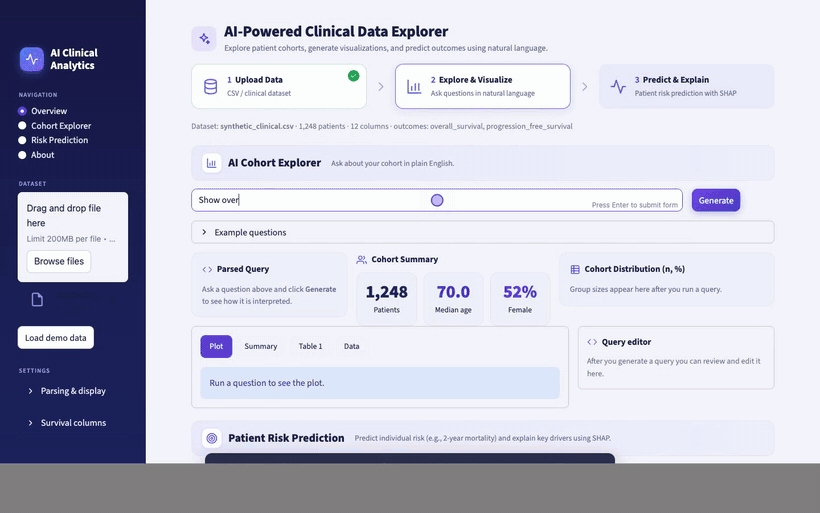

# AI-Powered Clinical Data Explorer

## 🎬 Demo

<p align="center">
  <a href="demo_video/demo.mp4">
    
  </a>
</p>

<p align="center">
  <b><a href="demo_video/demo.mp4">▶ Watch the full 2.5-minute narrated walkthrough (MP4)</a></b><br>
  Upload data → ask a question → Kaplan-Meier, summary table and Table 1 → edit the query → train XGBoost → predict and explain one patient with SHAP
</p>

The video is generated automatically by [`demo_video/make_demo_video.py`](demo_video/make_demo_video.py)
(Playwright drives the app in Chrome, edge-tts narrates, ffmpeg muxes). To re-create it:
`pip install playwright imageio-ffmpeg edge-tts && python -m playwright install ffmpeg && python demo_video/make_demo_video.py`.


## What's new in version 3

- `synthetic_clinical.csv` now has **progression-free survival** (`pfs_time`, `pfs_event`); the overall-survival
  columns were renamed `os_time` / `os_event`. `data_generate.R` was updated to match.
- **Richer Summary tab:** headline tiles, a per-group table (N, events, event rate, median follow-up, median
  survival and 12/24-month survival with 95% CI, HR vs reference, log-rank p) and CSV download.
- **New Table 1 tab:** baseline characteristics of the selected cohort, split by the grouping variable, with p-values.
- Bug fix in `query_engine.configure_outcomes`: a dataset that had `pfs_*` columns but non-standard overall-survival
  names (e.g. `time_months` / `event`) used to lose its overall-survival outcome.
- Packaging: `.gitignore` and `.streamlit/config.toml` are in their final locations.

An interactive clinical-analytics app that lets researchers **ask questions about a patient cohort in plain
language** and get validated cohort selections, **Kaplan-Meier survival analysis**, and **machine-learning risk
predictions with SHAP explanations**, without writing code.

> Built for a hackathon. Uses synthetic data only. Not for clinical decision-making.

---

## Table of contents

1. [Demo](#-demo)
1. [Features](#features)
2. [How it works](#how-it-works)
3. [Quick start](#quick-start)
4. [Using the app](#using-the-app)
5. [Data format](#data-format)
6. [Natural-language parsing](#natural-language-parsing)
7. [Statistical and ML methods](#statistical-and-ml-methods)
8. [Project structure](#project-structure)
9. [Running the self-tests](#running-the-self-tests)
10. [Using the modules from Python](#using-the-modules-from-python)
11. [Configuration](#configuration)
12. [Troubleshooting](#troubleshooting)
13. [Limitations](#limitations)

---

## Features

| # | Feature | What it does |
|---|---------|--------------|
| 1 | **Natural-language query** | Claude translates a question such as *"overall survival for patients older than 65, split by treatment"* into a structured JSON query. Every query is validated against the dataset, and an offline rule-based parser takes over if the LLM is unavailable. |
| 2 | **Cohort selection** | Validates the uploaded data, auto-detects the survival time / event columns, filters patients, and groups them by any categorical variable. |
| 3 | **Survival analysis** | Kaplan-Meier curves with 95% confidence bands, censoring marks and a number-at-risk table; median survival; survival at landmark times; log-rank test and Bonferroni-adjusted pairwise comparisons; a publication-style survival summary (event rate, median follow-up, median survival and landmark survival with 95% CI, HR vs reference) and a **Table 1** of baseline characteristics with p-values, both downloadable as CSV. Also histograms, box plots, bar charts, trend and scatter plots. |
| 4 | **ML risk prediction** | XGBoost Cox proportional-hazards model, C-index on a held-out split, **Low / Medium / High** risk tiers, individual survival probabilities, and SHAP explanations (global and per patient). |
| 5 | **Interactive dashboard** | Streamlit app combining data upload, question input, an editable query panel, plots, summary tables and the risk-prediction workflow. |

## How it works

```
 CSV upload / demo data
          │
          ▼
 ┌──────────────────┐    question     ┌─────────────────────────┐
 │  check_data()    │ ──────────────▶ │  nl_parser_v2           │
 │  detect survival │                 │  Claude → JSON          │
 │  columns         │                 │  validate → retry       │
 └──────────────────┘                 │  rule-based fallback    │
                                      └────────────┬────────────┘
                                                   │ Parsed Query (JSON, user-editable)
                                                   ▼
                                      ┌─────────────────────────┐
                                      │  query_engine           │
                                      │  filter → group         │
                                      └────────────┬────────────┘
                                                   ▼
                          ┌────────────────────────┴───────────────────────┐
                          ▼                                                ▼
              ┌───────────────────────┐                       ┌───────────────────────┐
              │ survival  (KM, log-   │                       │ plots (KM, histogram, │
              │ rank, landmarks)      │                       │ box, bar, trend)      │
              └───────────────────────┘                       └───────────────────────┘

 model.py: XGBoost Cox → risk tiers → SHAP  (Risk Prediction page)
```

`pipeline.py` chains parse → query → survival → plot into one UI-independent function. `app.py` only handles
presentation, and `ui.py` holds the CSS and HTML snippets.

## Quick start

Requirements: **Python 3.9+**. On macOS, xgboost also needs the OpenMP runtime (`libomp`).

```bash
git clone https://github.com/caiweizhong1999-code/Hackthon.git
cd Hackthon
git checkout Version2
```

```bash
python3 -m venv .venv
source .venv/bin/activate          # Windows: .venv\Scripts\activate
pip install -r requirements.txt
brew install libomp                # macOS only
```

```bash
streamlit run app.py
```

The app opens at https://h6wxdz2aqqlir2asjdgtrr.streamlit.app/. The first time it runs, Streamlit may ask for an email address; just
press **Enter** to skip.

**Optional: enable Claude parsing**

```bash
export ANTHROPIC_API_KEY=sk-ant-...
streamlit run app.py
```

You can also paste the key in the sidebar under **Settings → Parsing & display**. Without a key the app uses the
offline rule-based parser, so everything still works.

## Using the app

The sidebar has four pages: **Overview** (Cohort Explorer and Risk Prediction on one page), **Cohort Explorer**,
**Risk Prediction**, and **About**.

1. **Load data.** Click **Load demo data** (400 simulated patients with overall *and* progression-free survival),
   or upload a CSV such as the bundled `synthetic_clinical.csv` (1,248 patients, overall *and* progression-free survival).
2. **Check the survival columns.** They are auto-detected. If detection fails, pick them under
   **Settings → Survival columns**.
3. **Ask a question** in the Cohort Explorer and click **Generate**. Use **Example questions** for ideas.
   - *Parsed Query* shows the structured query and whether it came from the LLM, the rules fallback, or a manual edit.
   - *Cohort Summary* and *Cohort Distribution* show the cohort size, events and group sizes.
   - The **Plot / Summary / Table 1 / Data** tabs show the figure (downloadable as PNG), the survival summary
     (headline numbers, per-group table with HR and log-rank p, pairwise tests), a Table 1 of baseline
     characteristics for the selected cohort (split by the grouping variable), and the raw data. Both tables
     can be downloaded as CSV.
   - The **Query editor** lets you edit the JSON and re-run it. Parser notes explain any retries or fallbacks.
4. **Predict risk.** On the Risk Prediction page, choose the outcome and click **Train model**. Then fill in a
   patient's features, choose a prediction horizon and click **Predict Risk** to see the predicted risk, the risk
   level, and a SHAP chart of the main drivers. **Model performance & global drivers** shows the SHAP summary and
   importance plots, plus KM curves by predicted risk tier.

Example questions:

```
Show overall survival for patients older than 65, split by treatment
Overall survival for women aged 40 to 60, grouped by stage
Progression-free survival for stage III or IV patients by sex      (demo data)
Distribution of age by sex
Compare Treatment A and Treatment B survival time as a boxplot
How does mean survival time change with age?
```

## Data format

One row per patient. Required columns:

| Purpose | Accepted names (case-insensitive) | Values |
|---------|-----------------------------------|--------|
| Survival time | `os_time`, `os_months`, `time_months`, `survival_time`, `time_to_event`, `duration`, `time`, `months`, `followup_months`, … | numeric, ≥ 0 |
| Event indicator | `os_event`, `event`, `status`, `death`, `dead`, `os_status` | `1` = event occurred, `0` = censored |
| Progression-free survival (optional) | `pfs_time` + `pfs_event` | as above |

If your columns are named differently, select them in the sidebar. Columns whose name contains *censor* are
deliberately **not** auto-detected, because they usually use the opposite coding (1 = censored).

Any other columns (age, sex, stage, treatment, biomarkers, …) can be used for filtering, grouping and as model
features. ID-like and date-like columns are excluded from the model automatically.

`synthetic_clinical.csv` (generated by `data_generate.R`) contains:

| Column | Description |
|--------|-------------|
| `patient_id` | P0001 … P1248 |
| `age` | 40–90 years |
| `sex` | Female / Male |
| `stage` | I, II, III, IV |
| `ecog` | ECOG performance status 0–2 |
| `treatment` | Treatment A / B / C |
| `pdl1` | Positive / Negative (about 3% missing, to exercise validation) |
| `enroll_date` | enrollment date |
| `os_time` | overall-survival follow-up in months (administrative censoring at 36) |
| `os_event` | 1 = death, 0 = censored |
| `pfs_time` | progression-free survival time in months (`pfs_time` ≤ `os_time`) |
| `pfs_event` | 1 = progression or death, 0 = censored |

To regenerate it: `Rscript data_generate.R` from the project root. Note that the shipped CSV was produced by
adding the PFS columns to the earlier OS data (same patients, same OS times); re-running the R script draws new
random numbers, so you get a statistically similar but not identical file.

## Natural-language parsing

`nl_parser_v2.parse_query()` returns a **Parsed Query**:

```json
{
  "filters":   [{"column": "age", "op": ">", "value": 65}],
  "outcome":   "overall_survival",
  "group_by":  "treatment",
  "plot_type": "km_curve"
}
```

- `op` is one of `>`, `<`, `>=`, `<=`, `==`, `!=`, `in` (with a list). Multiple filters are combined with AND.
- `outcome` is `overall_survival`, `progression_free_survival`, or `null` for non-survival questions.
- `plot_type` is one of `km_curve`, `histogram`, `boxplot`, `bar`, `scatter`, `trend`.

**Parsing flow**

1. **LLM:** The system prompt contains the column names, types, numeric ranges, the values of low-cardinality
   categorical columns, the JSON schema, and few-shot examples. Claude returns JSON only.
2. **Validation:** `query_engine.validate_query()` checks that columns exist, operators are allowed, and values
   match the column type. Category values are matched case-insensitively (for example, `female` → `Female`).
3. **Retry:** If validation fails, the error is sent back to the LLM, up to 2 retries.
4. **Fallback:** If there is no API key, a network error, a timeout or no valid answer after retrying, a
   regex-based parser handles the question. It also understands Chinese questions such as
   `65岁以上女性患者按治疗方案分组的生存曲线`.

**Privacy:** only schema information (column names, ranges, category levels) is sent to the API. Patient-level
rows, identifiers and dates are never sent.

## Statistical and ML methods

**Survival analysis** (`survival.py`, pure NumPy, no lifelines dependency)

- Kaplan-Meier estimator with the Greenwood variance and a **log-log** 95% CI, so the bounds stay within [0, 1].
- Median survival and its 95% CI. "NR" means not reached.
- Survival probability S(t) at landmark times (configurable in the sidebar; default 12 and 24).
- Multi-group **log-rank** test (Mantel-Haenszel), plus pairwise log-rank tests with Bonferroni correction when
  there are 3 or more groups.
- Checked against R `survival` on the Freireich 6-MP leukemia data: χ² = 16.8, medians 23 and 8 weeks.

**Risk model** (`model.py`)

- XGBoost with `objective="survival:cox"`. Categorical features are one-hot encoded, and missing values are
  handled natively by XGBoost.
- Stratified 80/20 train/validation split with early stopping. **Harrell's C-index** is reported on both splits.
- **Breslow** baseline cumulative hazard, giving individual survival curves S(t | x) = exp(−H₀(t) · risk).
- **Risk tiers:** tertiles of predicted relative risk on the training data (Low / Medium / High).
- **SHAP:** XGBoost's built-in TreeSHAP (`pred_contribs=True`), in log-hazard units. Positive values increase risk.
  An additivity check confirms base value + Σ SHAP = model margin.
- Models can be saved and loaded (`model.json` + `meta.json`).

## Project structure

```
app.py                  Streamlit app: pages, sidebar, Cohort Explorer, Risk Prediction
ui.py                   CSS and HTML helpers (all data and user text is HTML-escaped)
pipeline.py             parse → query → survival → plot, data checks, demo data generator
nl_parser_v2.py         natural language → Parsed Query (Claude + validation retry + rule fallback)
query_engine.py         query validation, filtering and grouping; survival-column auto-detection
survival.py             Kaplan-Meier, log-rank, pairwise tests, summary tables
table1.py               Table 1 (baseline characteristics) and the publication-style survival summary
plots.py                KM curves with risk table, histogram, box, bar, trend, scatter
model.py                XGBoost Cox model, C-index, risk tiers, TreeSHAP, SHAP plots
data_loader.py          standalone CSV loading, type inference and validation utilities
nl_parser.py            first-generation parser (superseded by nl_parser_v2.py)
data_generate.R         generates synthetic_clinical.csv (base R)
synthetic_clinical.csv  sample dataset (1,248 patients)
test_loader.ipynb       notebook demo of data_loader
.streamlit/config.toml  theme (light main area, dark navy sidebar)
requirements.txt        Python dependencies
```

## Running the self-tests

Each module has a self-test in `if __name__ == "__main__":`. None of them needs an API key.

```bash
python query_engine.py && python survival.py && python table1.py && python nl_parser_v2.py && python plots.py && python model.py && python pipeline.py && python data_loader.py
```

- `survival.py`: compares KM and log-rank results with the published R results.
- `nl_parser_v2.py`: rule parsing in English and Chinese, plus a mock LLM that first returns an invalid query and
  then corrects it, and one that always fails so the parser falls back to rules.
- `model.py`: C-index > 0.6, SHAP additivity, monotone survival curves, save/load round-trip.
- `table1.py`: Table 1 and survival summary on `synthetic_clinical.csv`, plus a hazard-ratio sanity check.
- `pipeline.py`: end-to-end questions, user-friendly errors for empty cohorts and invalid edited queries.
- `plots.py` writes `demo_*.png`, and `model.py` writes `demo_shap_*.png`, into the current directory.

## Using the modules from Python

```python
import pandas as pd
from query_engine import configure_outcomes
from pipeline import run_question
from model import SurvivalXGB

df = pd.read_csv("synthetic_clinical.csv")
configure_outcomes(df)                      # os_time/os_event and pfs_time/pfs_event

out = run_question("patients older than 65, survival by treatment", df)   # client=None → rule parser
print(out.parsed.query, out.result.n_selected)
print(out.report.logrank)                   # log-rank chi2(2) = ..., p < 0.001
out.fig.savefig("km.png")

model = SurvivalXGB("overall_survival").fit(df)
print(model.metrics_)                       # n, events, c_index_train, c_index_val
print(model.risk_group(df).value_counts())  # Low / Medium / High
```

To use Claude, pass `client=anthropic.Anthropic()` to `run_question`. The model can be changed with `MODEL` in
`nl_parser_v2.py` (default `claude-sonnet-5-5`).

## Configuration

| Setting | Where |
|---------|-------|
| Anthropic API key | `ANTHROPIC_API_KEY` environment variable, or sidebar → Settings |
| LLM on/off | sidebar → Settings → *Use LLM parsing* |
| Time unit and landmark times | sidebar → Settings |
| Survival columns | sidebar → Survival columns (auto-detected by default) |
| Theme | `.streamlit/config.toml` |
| LLM model, retries | `MODEL`, `MAX_RETRIES` in `nl_parser_v2.py` |
| XGBoost hyper-parameters | `DEFAULT_PARAMS` in `model.py` |

## Troubleshooting

| Problem | Fix |
|---------|-----|
| `XGBoost Library (libxgboost.dylib) could not be loaded` | macOS: `brew install libomp` |
| Streamlit asks for an email address on first run | Press Enter, or run `streamlit run app.py --server.headless true` |
| `Port 8501 is already in use` | Another app is running. Use the URL Streamlit prints (e.g. :8502), or stop the old one with Ctrl+C |
| "Could not find a survival time column…" | Select the time and event columns under Settings → Survival columns |
| Parser badge says *Rules fallback* | No API key, or the LLM call failed. See *Parser notes* for the reason |
| `NotOpenSSLWarning` from urllib3 | Harmless on the macOS system Python; it can be ignored |

## Limitations

- The risk model is validated only on a random internal split. It is not a substitute for external or temporal
  validation, and it is **not intended for clinical decision-making**.
- SHAP shows what the model relies on, not causal effects.
- Risk tiers are relative to the training cohort. KM curves by risk tier are drawn on the training data, so the
  separation between tiers looks better than it would on new patients.
- The rule-based fallback covers common phrasings only. Use the LLM or edit the query JSON for complex questions.
